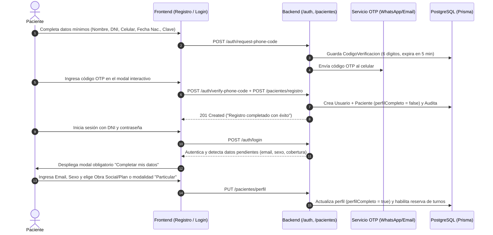
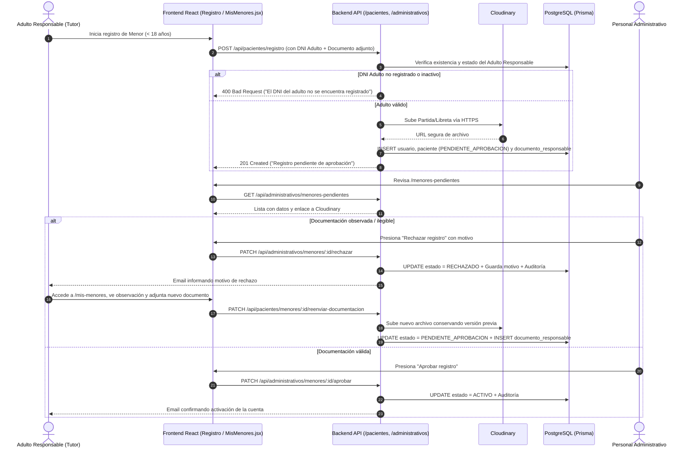
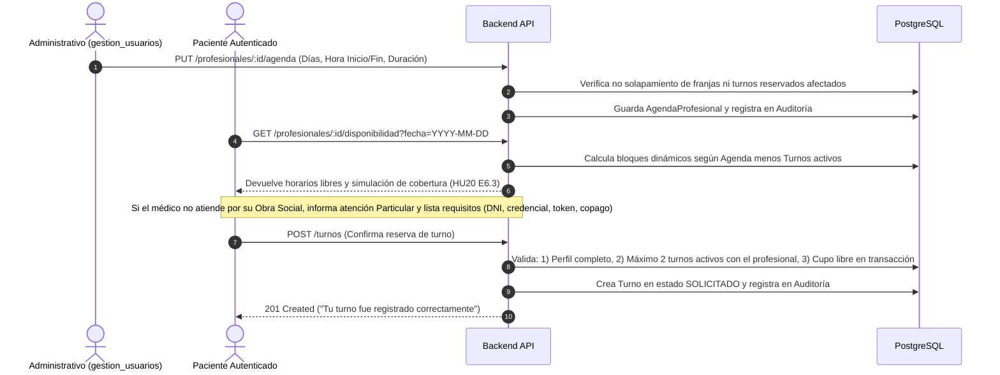
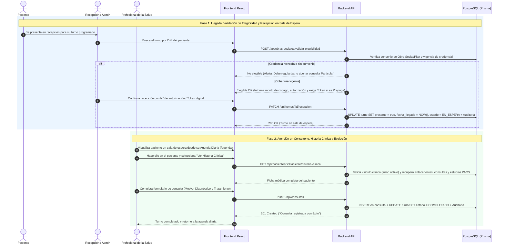
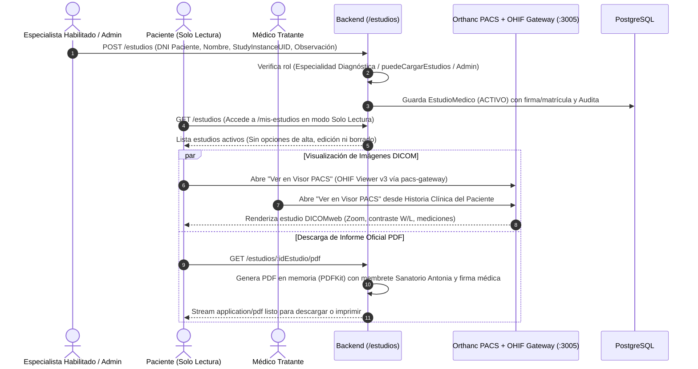
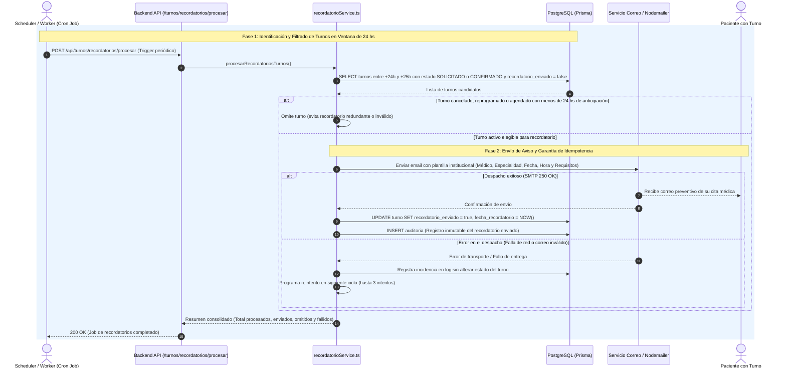
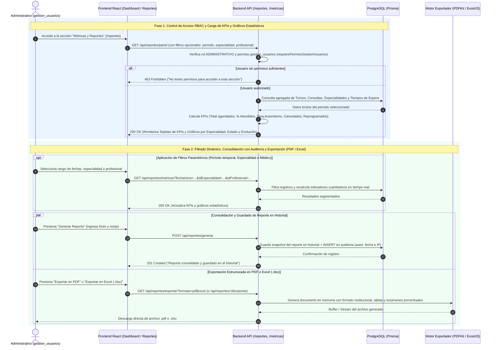

# Catálogo Oficial de Flujos del Sistema — Sanatorio Antonia

Este documento constituye el índice técnico y catálogo consolidado de todos los **Flujos del Sistema**, organizados con sus nombres definitivos, Historias de Usuario asociadas, descripciones funcionales, código Mermaid en formato Diagrama de Secuencia Técnico y sus correspondientes imágenes renderizadas en alta resolución.

---

## 1. Índice de Flujos Implementados (Oficiales)

| Flujo | Nombre Oficial del Flujo | Historias de Usuario (HUs) | Imagen Asociada |
|:---:|---|:---:|---|
| **Flujo 1** | Registro de Paciente, Validación OTP de Celular y Completitud de Perfil | **HU1 y HU2** | [`Flujo1_Registro_Paciente_OTP_Perfil_HU1_HU2.jpg`](./imagenes/Flujo1_Registro_Paciente_OTP_Perfil_HU1_HU2.jpg) |
| **Flujo 2** | Registro de Menor de Edad, Aprobación Administrativa y Reenvío de Documentación | **HU1 y HU13** | [`Flujo2_Registro_Menor_Aprobacion_Reenvio_Doc_HU1_HU13.jpg`](./imagenes/Flujo2_Registro_Menor_Aprobacion_Reenvio_Doc_HU1_HU13.jpg) |
| **Flujo 3** | Configuración de Agenda Médica, Reserva de Turno y Simulación de Cobertura | **HU19, HU3 y HU20** | [`Flujo3_Configuracion_Agenda_Reserva_Simulacion_Cobertura_HU19_HU3_HU20.jpg`](./imagenes/Flujo3_Configuracion_Agenda_Reserva_Simulacion_Cobertura_HU19_HU3_HU20.jpg) |
| **Flujo 4** | Recepción en Consultorio, Validación de Elegibilidad y Atención Médica | **HU12, HU20, HU16, HU8 y HU7** | [`Flujo4_Recepcion_Elegibilidad_Atencion_Medica_HU12_HU20_HU16_HU8_HU7.jpg`](./imagenes/Flujo4_Recepcion_Elegibilidad_Atencion_Medica_HU12_HU20_HU16_HU8_HU7.jpg) |
| **Flujo 5** | Ciclo de Estudios Médicos, Visor DICOM PACS e Informe PDF Oficial | **HU21 y HU8 E4** | [`Flujo5_Ciclo_Estudios_Visor_PACS_Informe_PDF_HU21_HU8_E4.jpg`](./imagenes/Flujo5_Ciclo_Estudios_Visor_PACS_Informe_PDF_HU21_HU8_E4.jpg) |
| **Flujo 6** | Envío Automático de Recordatorios de Turnos 24 Horas Antes | **HU23** | [`Flujo6_Envio_Automatico_Recordatorios_24h_HU23.jpg`](./imagenes/Flujo6_Envio_Automatico_Recordatorios_24h_HU23.jpg) |
| **Flujo 7** | Panel Gerencial de Métricas, Gráficos Estadísticos y Exportación de Reportes | **HU18** | [`Flujo7_Panel_Metricas_Graficos_Exportacion_Reportes_HU18.jpg`](./imagenes/Flujo7_Panel_Metricas_Graficos_Exportacion_Reportes_HU18.jpg) |

---

## 2. Detalle y Diagramas de Secuencia por Flujo

### Flujo 1: Registro de Paciente, Validación OTP de Celular y Completitud de Perfil (HU1 y HU2)
- **HUs Implicadas:** 
  - `HU1`: Registro de Pacientes en la web (con validación de celular por OTP).
  - `HU2`: Inicio de Sesión y pantalla "Completar mis datos" (Email, Sexo, Cobertura optativa).
- **Descripción:** El paciente completa datos mínimos, valida su línea celular ingresando un código OTP de 6 dígitos (expira en 5 min) y se crea la cuenta. Al ingresar por primera vez, el sistema detecta datos pendientes y exige completar email, sexo y definir si posee obra social/plan o si se atiende de forma `PARTICULAR`.
- **Archivo de Imagen:** [`Flujo1_Registro_Paciente_OTP_Perfil_HU1_HU2.jpg`](./imagenes/Flujo1_Registro_Paciente_OTP_Perfil_HU1_HU2.jpg)

---

### Flujo 2: Registro de Menor de Edad, Aprobación Administrativa y Reenvío de Documentación (HU1 y HU13)
- **HUs Implicadas:**
  - `HU1`: Registro de menor de edad con adulto responsable y carga de documentación.
  - `HU13`: Bandeja administrativa de aprobación/rechazo de menores y módulo "Menores a cargo" (`MisMenores.jsx`) con reenvío de documentación corregida.
- **Descripción:** Alta de menor de edad vinculando el DNI del tutor y adjuntando partida de nacimiento/libreta en Cloudinary. Si la administración observa el documento, el adulto ingresa a `/mis-menores`, ve la observación y reenvía una versión legible sin perder el historial.
- **Archivo de Imagen:** [`Flujo2_Registro_Menor_Aprobacion_Reenvio_Doc_HU1_HU13.jpg`](./imagenes/Flujo2_Registro_Menor_Aprobacion_Reenvio_Doc_HU1_HU13.jpg)

---

### Flujo 3: Configuración de Agenda Médica, Reserva de Turno y Simulación de Cobertura (HU19, HU3 y HU20)
- **HUs Implicadas:**
  - `HU19`: Configuración de la agenda del profesional (días, franjas y duración).
  - `HU3`: Solicitud de turnos web por el paciente (límite de 2 turnos activos y cálculo dinámico).
  - `HU20`: Simulador de cobertura médico-paciente y listado de requisitos de consulta.
- **Descripción:** El administrativo define la agenda del profesional. El paciente consulta disponibilidad en tiempo real, recibe la simulación de cobertura (si el médico no atiende su obra social, se advierte consulta Particular) y reserva su cupo con control de solapamiento.
- **Archivo de Imagen:** [`Flujo3_Configuracion_Agenda_Reserva_Simulacion_Cobertura_HU19_HU3_HU20.jpg`](./imagenes/Flujo3_Configuracion_Agenda_Reserva_Simulacion_Cobertura_HU19_HU3_HU20.jpg)

---

### Flujo 4: Recepción en Consultorio, Validación de Elegibilidad y Atención Médica (HU12, HU20, HU16, HU8 y HU7)
- **HUs Implicadas:**
  - `HU12`: Gestión de turnos y recepción en sala de espera.
  - `HU20`: Validación de elegibilidad de afiliados, credenciales y token digital de prepagas.
  - `HU16`: Agenda Diaria del profesional.
  - `HU8`: Historia Clínica del paciente (con vínculo clínico).
  - `HU7`: Registro de consulta y evolución médica.
- **Descripción:** En mesa de entradas se valida la elegibilidad de la cobertura y se registra la recepción (`EN_ESPERA`). El profesional ve al paciente en su agenda diaria, abre la historia clínica, revisa antecedentes y estudios, y registra la consulta pasando el turno a `COMPLETADO`.
- **Archivo de Imagen:** [`Flujo4_Recepcion_Elegibilidad_Atencion_Medica_HU12_HU20_HU16_HU8_HU7.jpg`](./imagenes/Flujo4_Recepcion_Elegibilidad_Atencion_Medica_HU12_HU20_HU16_HU8_HU7.jpg)

---

### Flujo 5: Ciclo de Estudios Médicos, Visor DICOM PACS e Informe PDF Oficial (HU21 y HU8 E4)
- **HUs Implicadas:**
  - `HU21`: Gobernanza de estudios médicos (carga restringida a especialistas diagnósticos/admin y modo solo lectura para pacientes).
  - `HU8 E4`: Pestaña de Estudios Médicos en la Historia Clínica del médico tratante.
- **Descripción:** El especialista autorizado registra el estudio vinculando el `StudyInstanceUID`. El paciente accede a `/mis-estudios` en modo solo lectura, visualizando las imágenes en el visor **OHIF Viewer v3** (vía Nginx gateway con `COOP/COEP`) y descargando el informe oficial generado dinámicamente con **PDFKit**.
- **Archivo de Imagen:** [`Flujo5_Ciclo_Estudios_Visor_PACS_Informe_PDF_HU21_HU8_E4.jpg`](./imagenes/Flujo5_Ciclo_Estudios_Visor_PACS_Informe_PDF_HU21_HU8_E4.jpg)

---

### Flujo 6: Envío Automático de Recordatorios de Turnos 24 Horas Antes (HU23)
- **HUs Implicadas:**
  - `HU23`: Envío automático de recordatorios preventivos de turnos 24 hs previas a la cita.
- **Descripción:** Un scheduler periódico ejecuta `procesarRecordatoriosTurnos()`. Detecta turnos activos entre +24h y +25h sin aviso previo y despacha correos vía Nodemailer. Al confirmarse el envío, marca `recordatorioEnviado = true` con trazabilidad e idempotencia en PostgreSQL.
- **Archivo de Imagen:** [`Flujo6_Envio_Automatico_Recordatorios_24h_HU23.jpg`](./imagenes/Flujo6_Envio_Automatico_Recordatorios_24h_HU23.jpg)

---

### Flujo 7: Panel Gerencial de Métricas, Gráficos Estadísticos y Exportación de Reportes (HU18)
- **HUs Implicadas:**
  - `HU18`: Panel gerencial de métricas, gráficos estadísticos y generación/exportación de reportes en PDF y Excel.
- **Descripción:** El administrativo con permiso `gestion_usuarios` accede a `/reportes`. El backend calcula KPIs operativos (volumen, % atención, ausentismo, tiempos de espera) y permite consolidar snapshots auditados o exportar archivos estructurados en **PDF** o **Excel (`.xlsx`)** generados en memoria.
- **Archivo de Imagen:** [`Flujo7_Panel_Metricas_Graficos_Exportacion_Reportes_HU18.jpg`](./imagenes/Flujo7_Panel_Metricas_Graficos_Exportacion_Reportes_HU18.jpg)

---

## 3. Flujos Pospuestos y Fuera de Alcance

1. **Flujo A: Gestión de Turnos por Chatbot de WhatsApp (`HU4`)** — Pospuesto para la fase de cierre; en su lugar se implementó la validación OTP vía celular.
2. **Flujo B: Registro de Pacientes vía Chatbot de WhatsApp (`HU5`)** — Pospuesto por requerimientos legales y documentales resueltos en el portal web.
3. **Flujo C: Edición y Baja Lógica de Usuarios Administrativos (`HU22`)** — Pospuesto; la gestión de administrativos se mantiene con alta y permisos `gestion_usuarios`.
4. **Flujo D: Prescripción Médica Digital con Firma Electrónica e Interoperabilidad con Farmacias** — Fuera de alcance inicial.
5. **Flujo E: Validación Federada con RENAPER / Mi Argentina** — Fuera de alcance inicial.
6. **Flujo F: Facturación Electrónica y Caja Diaria** — Fuera de alcance inicial.

---

## 4. Directorio de Imágenes y Diagramas de Arquitectura

Todos los diagramas técnicos están almacenados en la subcarpeta [`imagenes/`](./imagenes/):

- [`imagenes/Flujo1_Registro_Paciente_OTP_Perfil_HU1_HU2.jpg`](./imagenes/Flujo1_Registro_Paciente_OTP_Perfil_HU1_HU2.jpg)
- [`imagenes/Flujo2_Registro_Menor_Aprobacion_Reenvio_Doc_HU1_HU13.jpg`](./imagenes/Flujo2_Registro_Menor_Aprobacion_Reenvio_Doc_HU1_HU13.jpg)
- [`imagenes/Flujo3_Configuracion_Agenda_Reserva_Simulacion_Cobertura_HU19_HU3_HU20.jpg`](./imagenes/Flujo3_Configuracion_Agenda_Reserva_Simulacion_Cobertura_HU19_HU3_HU20.jpg)
- [`imagenes/Flujo4_Recepcion_Elegibilidad_Atencion_Medica_HU12_HU20_HU16_HU8_HU7.jpg`](./imagenes/Flujo4_Recepcion_Elegibilidad_Atencion_Medica_HU12_HU20_HU16_HU8_HU7.jpg)
- [`imagenes/Flujo5_Ciclo_Estudios_Visor_PACS_Informe_PDF_HU21_HU8_E4.jpg`](./imagenes/Flujo5_Ciclo_Estudios_Visor_PACS_Informe_PDF_HU21_HU8_E4.jpg)
- [`imagenes/Flujo6_Envio_Automatico_Recordatorios_24h_HU23.jpg`](./imagenes/Flujo6_Envio_Automatico_Recordatorios_24h_HU23.jpg)
- [`imagenes/Flujo7_Panel_Metricas_Graficos_Exportacion_Reportes_HU18.jpg`](./imagenes/Flujo7_Panel_Metricas_Graficos_Exportacion_Reportes_HU18.jpg)
- [`imagenes/arquitectura_tecnica_detallada_sanatorio_antonia.jpg`](./imagenes/arquitectura_tecnica_detallada_sanatorio_antonia.jpg)
- [`imagenes/arquitectura_ehr_ris_pacs_sprint3.jpg`](./imagenes/arquitectura_ehr_ris_pacs_sprint3.jpg)
